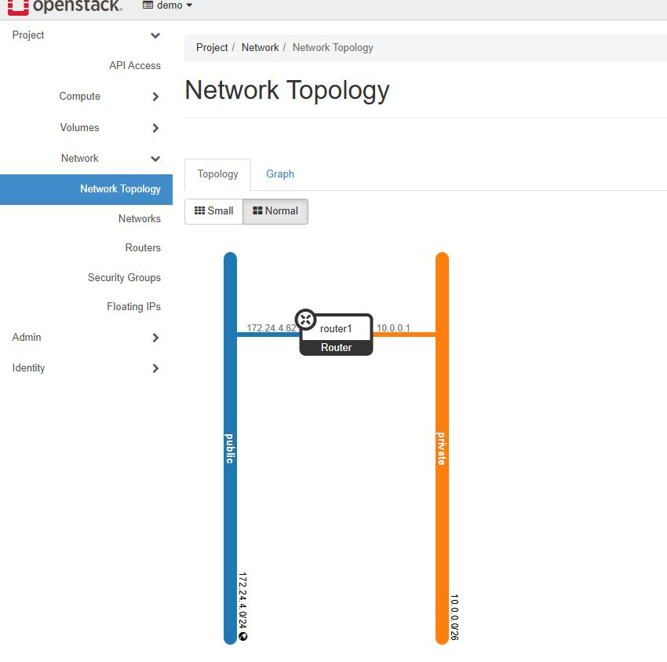
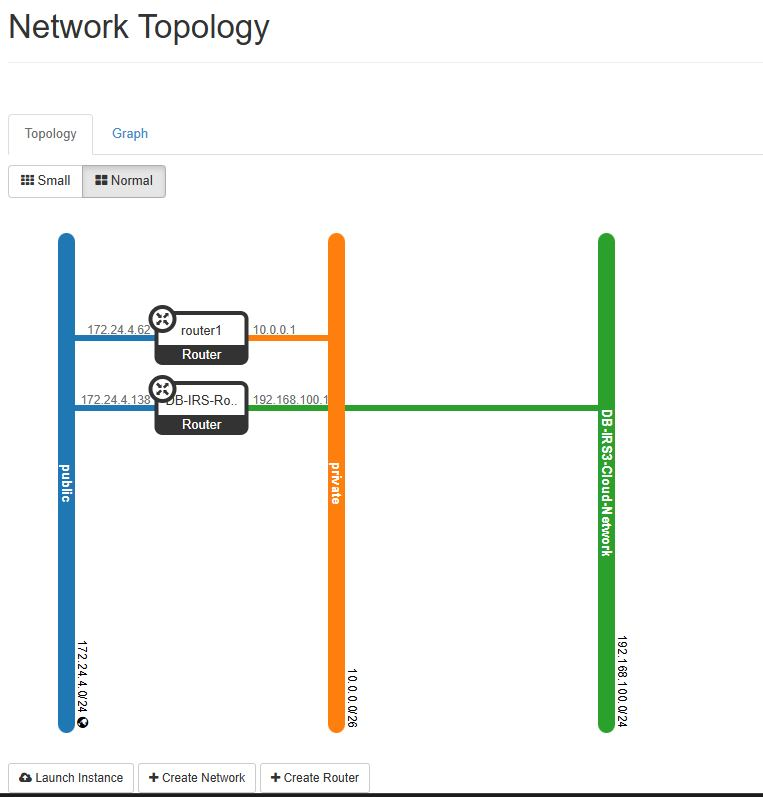
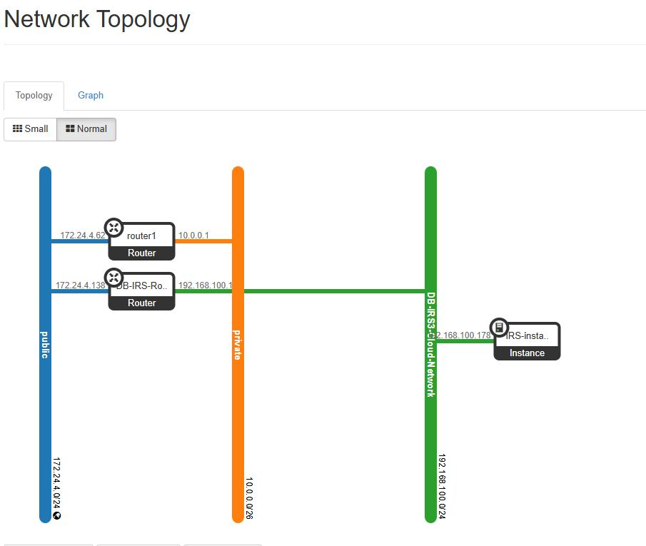
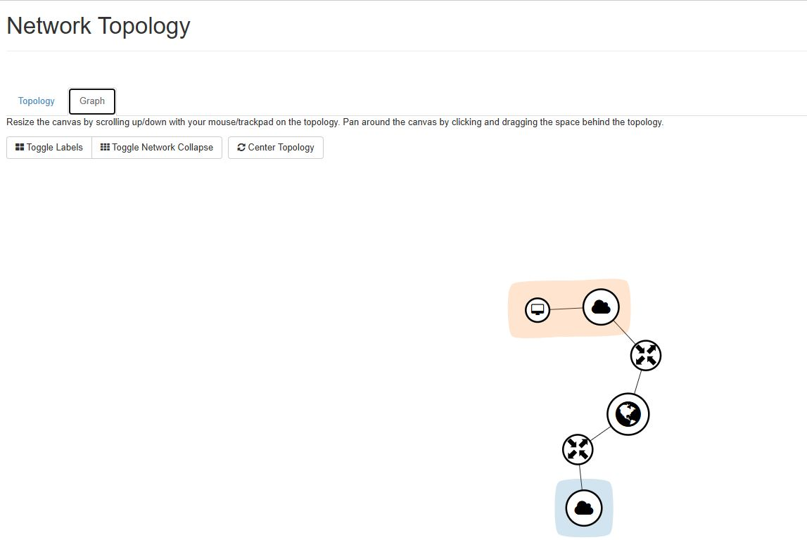
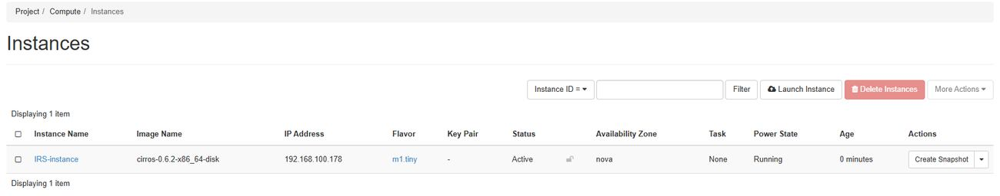
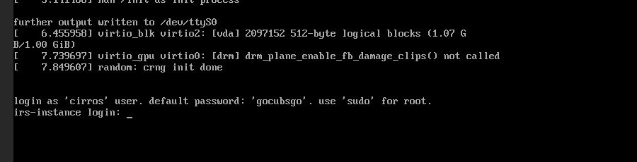

# OpenStack Private Cloud Lab (DevStack on VirtualBox)

Hands-on lab: building a single-node **private cloud** with OpenStack, then using the Horizon dashboard to design an isolated network and launch an instance.
Done for the *Cloud Services Deployment* course (ISI Tunis, 3rd year Network Engineering & Services).

## What I built

- A VirtualBox VM running **Ubuntu Server 22.04.5 LTS** (8 GB RAM, 4 vCPUs, ~60 GB disk, NAT + host-only network adapters)
- **OpenStack** installed with **DevStack** (branch `unmaintained/2024.1`): Keystone, Glance, Nova, Placement, Neutron (OVN), Cinder, Horizon
- A dedicated tenant network for a database tier, routed to the public network:
  - Network `DB-IRS3-Cloud-Network`, subnet `192.168.100.0/24`, DHCP enabled
  - Router `DB-IRS-Router` (external gateway on `public`, interface on the DB subnet)
  - Instance `IRS-instance` (CirrOS image, `m1.tiny` flavor) attached to that network

```
                 public (172.24.4.0/24)
                    |             |
                 router1     DB-IRS-Router
                    |             |
            private (10.0.0.0/26)  DB-IRS3-Cloud-Network (192.168.100.0/24)
                                      |
                                 IRS-instance (192.168.100.178)
```

## Architecture

| Component | Role in this lab |
|---|---|
| Keystone | Authentication (`admin`, `demo` users and projects) |
| Glance | CirrOS image used to boot the instance |
| Nova + Placement | Schedules and runs the instance on the single compute node |
| Neutron (ML2/OVN) | Networks, subnets, routers, DHCP, metadata |
| Cinder (LVM) | Block storage (installed, not used in this lab) |
| Horizon | Web dashboard used for all the network and instance steps |

## Setup summary

1. Create the VM (NAT adapter for Internet + host-only adapter, here `192.168.56.105`) and install Ubuntu Server.
2. Create the `stack` user with sudo rights, extend the LVM volume to the full disk.
3. Clone DevStack, check out `unmaintained/2024.1`, add [`config/local.conf`](config/local.conf).
4. Run `./stack.sh` (inside `tmux`, it takes a long time).
5. Open `http://<HOST_IP>/dashboard`, log in as `admin`, and follow the lab steps (see screenshots).

## Screenshots

| | |
|---|---|
|  |  |
|  |  |
|  |  |

## Troubleshooting

The DevStack install did not finish cleanly on the first try. The 11 problems I hit (wrong ISO, missing branch, Apache `mod_wsgi` error, empty Neutron geneve table, Glance 503/500, Horizon 403, Placement "No valid host", metadata agent) and how I fixed each one are in [docs/troubleshooting.md](docs/troubleshooting.md).

## Notes

- Lab only. Passwords in `config/local.conf` are placeholders; never reuse them.
- DevStack is not meant for production.
